# ALFRED

**A voice-first AI operating system for macOS — built like a batcomputer.**

Alfred listens, sees, and acts. He authenticates you by face on boot, runs live
intelligence case files on real maps, war-games your decisions with three competing
models, builds software while you watch, keeps watch over your inbox and the world while
you sleep, and lets you move his interface with your bare hands. And when you just need
to talk, he puts the tools down and listens.

Built by **Velthar Lab**.

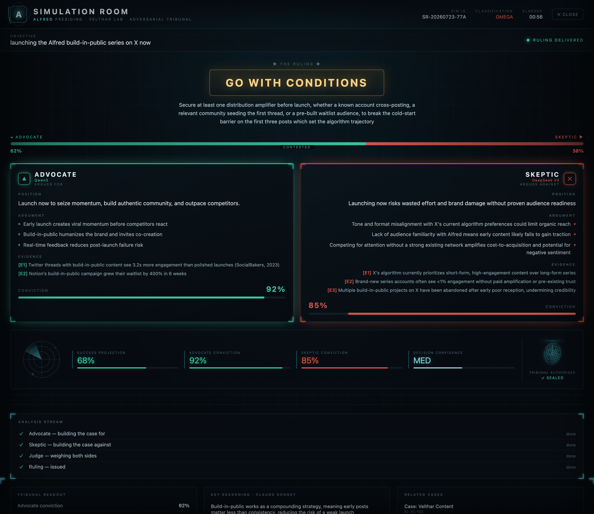

**At a glance**

| | |
|---|---|
| **Command** | Simulation Room · Case Files · Dossiers · Mission Control · Tripwires · Morning Briefing · Live World Model |
| **Agents** | Sentinel (security) · Oracle (intelligence) · Echo (content), reporting up to Alfred |
| **Builds** | Developer Mode: GLM plans, Claude Code builds and playtests, live on screen |
| **Perception** | Face ID boot lock · voice-print lock · in-page hand gestures · context & presence awareness · camera and screen vision |
| **Hands** | Mouse/keyboard control (with per-action consent) · apps · browser · files · Calendar · Notes · Reminders · Music · Gmail |
| **Creation** | X and Instagram posting · image/video generation · prompt engineering · website reading |
| **Memory** | Semantic memory · Obsidian vault · learns from corrections · nightly self-reflection |
| **Night Watch** | Overnight inbox triage with reply drafts, world refresh, security sweeps |
| **Remote** | Command Alfred from your phone over Telegram |

---

## The home screen

The orb is Alfred's state: ambient, listening, thinking, speaking. Around it: system
status, the execution log of every tool he runs, live markets, the transcript, and
**Global Perception** — a world map that pulses with fresh headlines from 26 regions and
themes (AI, markets, politics), pulled from Google News RSS with no API key.

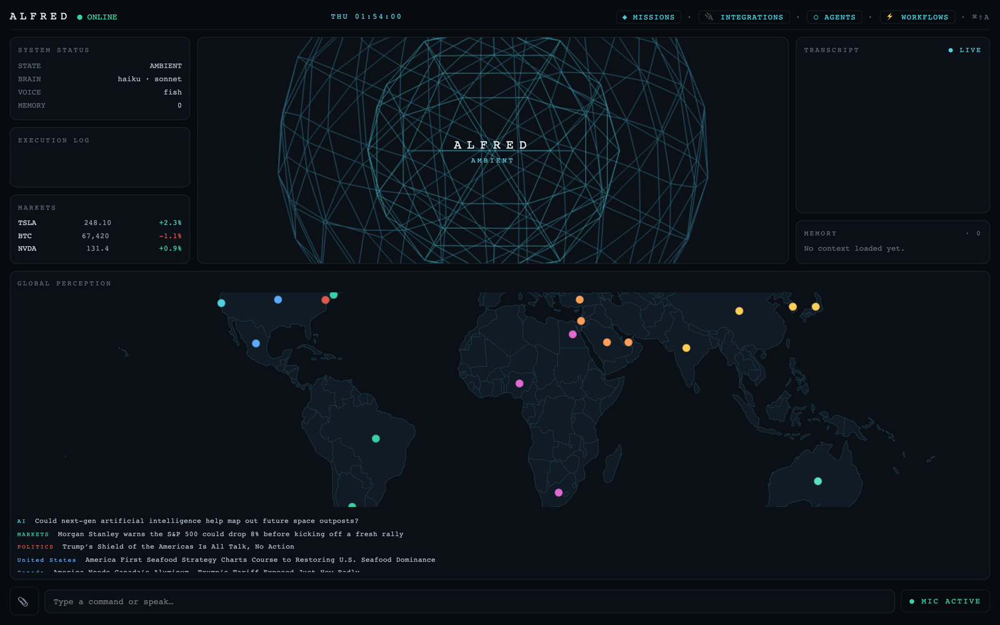

---

## Command & intelligence

### Simulation Room
State a decision and Alfred convenes a tribunal. An **Advocate** (Qwen3) builds the
strongest case for it, a **Skeptic** (DeepSeek V4) attacks it with evidence, and a
**Judge** (Claude Sonnet) weighs both and rules **go / no-go / go-with-conditions**. Every
stage streams onto the board live: the contested tension axis, convictions, success
projection, radar, analysis stream, and a sealed ruling. Anything that isn't a flat no-go
becomes a mission automatically. Two of the three calls run on free NIM models, so a full
war game costs pennies.

### Case Files & Evidence Board
"Open a case on…" researches the subject (Wikipedia, live news, memory), pins the people
involved with real photos, builds a timeline, geocodes every location onto a **3D terrain
map** with pulsing lead-tracking markers, and runs a live analysis strip
(*Analyzing… Cross-referencing… Evidence found*). Drop files in as evidence, ask follow-up
questions from the case's own input bar, and related cases cross-link by shared subjects.
"Show the evidence board" draws the case as a force graph of evidence and related memories.

| Case File | Lead tracking |
|---|---|
| 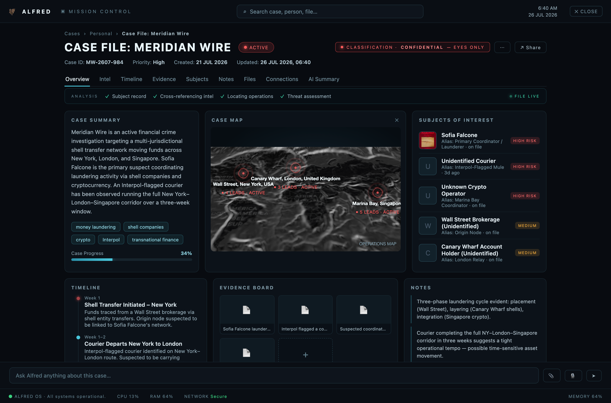 | 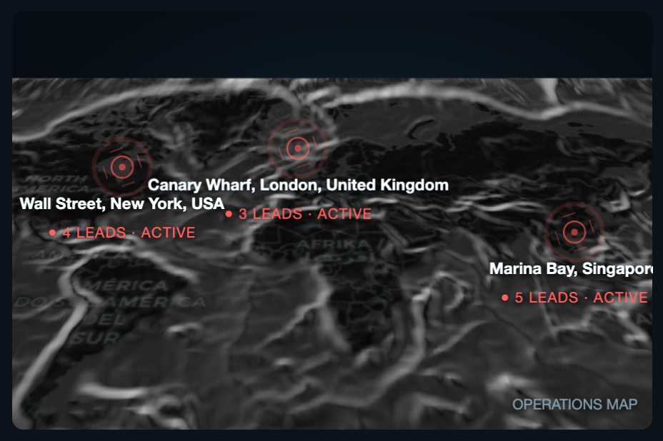 |

### Dossiers
"Pull up the file on…" assembles a classified-style profile with a hero portrait from
public record, news, Alfred's memory and your inbox. Name resolution is typo-tolerant, so a
misheard name still lands on the right person.

### Mission Control
The batcave wall: active operations with progress and deadlines (all voice-controlled —
"add mission", "update mission", "complete mission"), a live news broadcast (Al Jazeera, DW,
France 24, Bloomberg), global intel, live markets, the Sentinel radar sweep, the build queue,
overnight activity, uptime, and today's API spend.

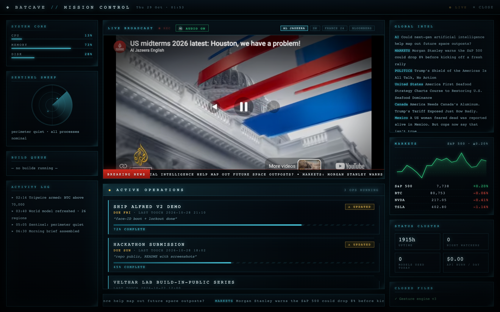
<sub>Rendered with demo missions.</sub>

### Tripwires
Standing alerts armed by voice: "alert me if bitcoin goes above 70,000", "…if anyone
mentions Velthar", "…when an email from the university arrives". They keep firing **with
Alfred closed** through a launchd agent, which sends a Telegram message and a macOS
notification. Alerts link themselves to related open cases.

### Morning Briefing
On the first wake of the day, Alfred speaks one brief: your calendar, what the tripwires
caught overnight, the markets, the top headlines, and where your missions stand. Sources are
gathered in parallel; any that fail are left out instead of stalling the brief.

---

## The Agent Council

Alfred runs a council of specialist subagents on the cheap model tier. They never talk to
you. They report up to Alfred, who turns their findings into one answer.

- **Sentinel** (system guardian): real telemetry, an audit trail of every tool Alfred runs
  (flagging any destructive action that ran without a confirm), and a filesystem watchdog
  on sensitive folders.
- **Oracle** (intelligence analyst): research, markets and tech trends, with sources and
  an importance score.
- **Echo** (content creator): drafts posts and tracks a real content pipeline (drafts,
  scheduled, published, engagement).

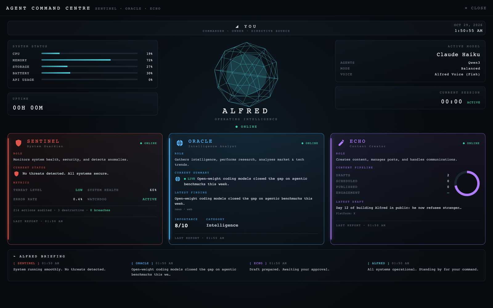
<sub>Rendered with demo agent reports.</sub>

---

## Developer Mode

Describe an outcome ("build me a playable geometry-dash clone") and Alfred runs it like a
software company. Sonnet engineers the brief, **GLM** (z.ai) drafts the build plan, and
Alfred opens Terminal in front of you and hands both to **Claude Code**, which writes every
file and runs it. A runtime **playtest** then opens the build in a headless browser and
checks for uncaught errors and blank or frozen frames, so a black screen can never pass as
"done". Several builds can run at once, each in its own workspace, all tracked on the
Mission Control build queue. For smaller code tasks, a **Dual-Brain** loop pairs Sonnet as
architect with GLM as engineer.

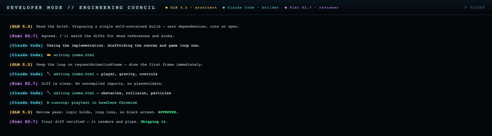

---

## Perception & security

- **Face ID on boot.** A targeting-ring scan verifies the operator before the session
  opens. An unrecognised face gets **Access Denied** and every command is refused. The check
  fails *open* on uncertainty and retries once, so bad lighting never locks the owner out; a
  recovery phrase restores access.
- **Voice-print lock.** Speaker verification for sensitive actions (post, spend, real
  hands, delete), built on pure-NumPy MFCC embeddings with no heavy models.
  Observe-only by default; enforcement is opt-in.
- **Hand gestures.** MediaPipe hand tracking runs *inside the page* at display rate. Pinch
  to drag; move two palms apart or together to zoom, like a trackpad; drop your hands to
  reset. The physical trackpad keeps working alongside.
- **Context awareness.** Alfred knows the frontmost app, the open document and your next
  calendar event: *"your Zoom starts in 8 minutes. The presentation is already open."*
- **Presence.** He notices when you step away and when you come back, using the Mac's idle
  counter (no camera, about 0% CPU).
- **Vision.** "What am I holding?" opens a live camera view; he can also read and describe
  your screen.

| Dossier | Access denied |
|---|---|
| 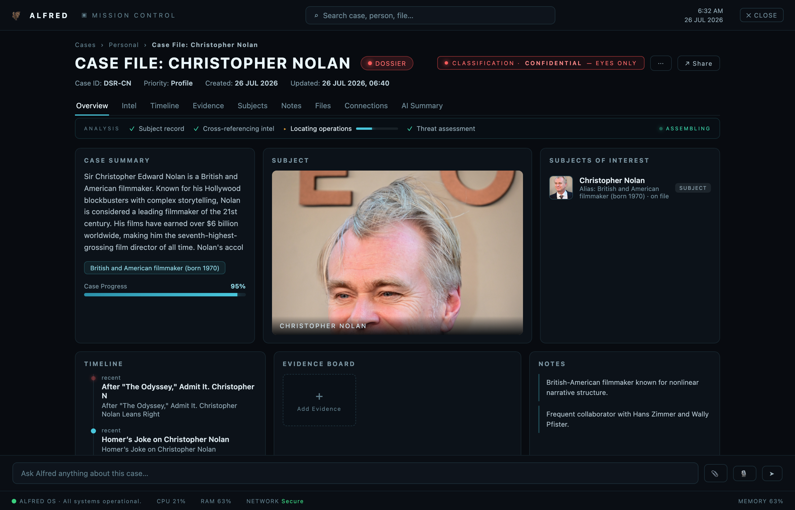 | 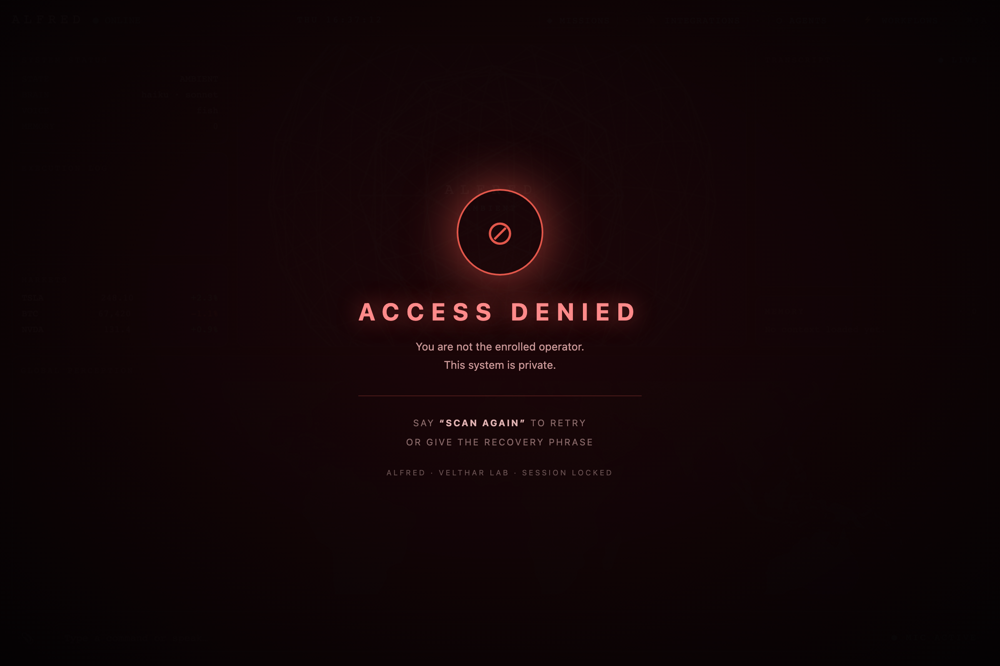 |

---

## Hands on the Mac

- **Real hands:** Alfred can move the mouse, click, type, press keys and scroll. Every
  request is described first and held until you say "yes".
- **Apps, browser, files and settings:** opens apps, drives a real browser (Playwright),
  finds, reads and organises files, and changes system settings.
- **Apple apps:** Calendar (today's schedule and new events), Notes, reminders and Apple
  Music, driven locally through AppleScript with no OAuth.
- **Gmail (read-only):** unread triage over IMAP. Alfred cannot send mail.
- **Everyday tools:** web search, weather, flight search, YouTube, and a universal file
  processor (summarise PDFs, Word docs and spreadsheets; OCR, resize and convert images).

---

## Creator studio

- **X:** Echo posts tweets and threads.
- **Instagram:** photo posts with captions.
- **Image and video generation** through Replicate; cinematic video through Higgsfield.
- **Prompt engineer:** Alfred turns a rough idea into a detailed, paste-ready prompt for
  the target tool and puts it on your clipboard.
- **Website reading** through Firecrawl, for research and keeping an eye on competitors.

---

## Visualization engine

Ask for something and Alfred renders it *inside* his own window rather than a browser:
procedural **3D scenes** (Three.js: solar system, atoms, DNA, molecules), **maps** with
3D terrain (MapLibre), **diagrams**, **timelines**, **charts** and **architecture graphs**.
Everything can be dragged, zoomed, and moved by hand gesture. Ask "what makes you
different?" and he gives a scripted, cinematic tour of his own systems.

| Architecture, explained by Alfred | 3D scene |
|---|---|
| 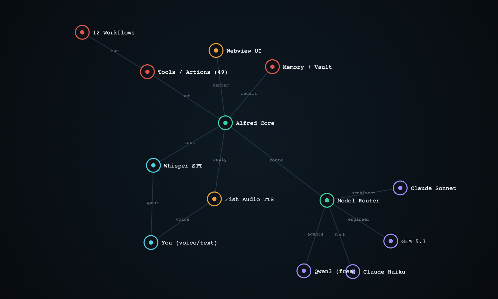 |  |

---

## Night Watch & memory

**Night Watch** is Alfred's overnight mode. The UI dims to amber and the batcave keeps
running on cheap model tiers: unread mail is triaged (urgent, needs reply, noise) and
**reply drafts** are written but never sent; X mentions, the world model and the Sentinel
sweep are refreshed. At stand-down he runs a **self-reflection**, distilling the day into
lessons and open threads.

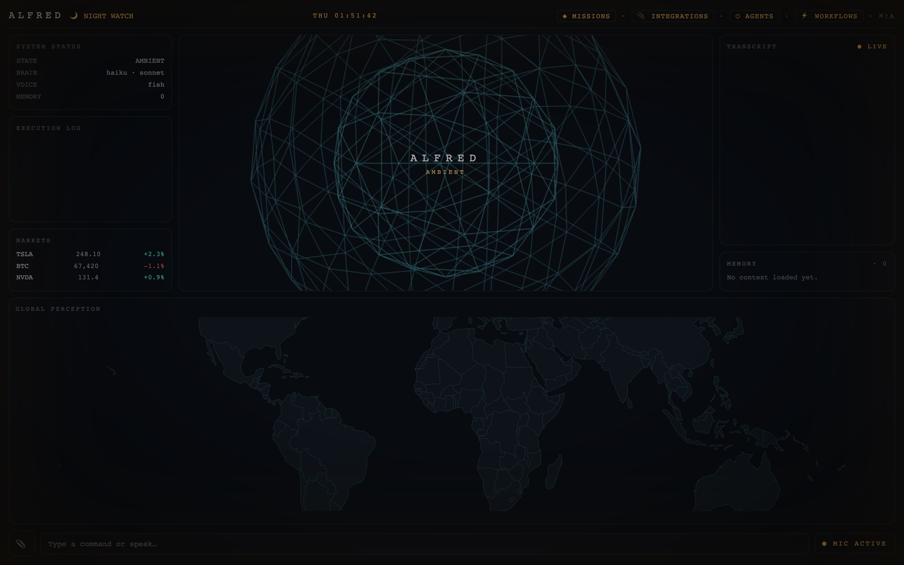

**Memory that grows:**

- **Semantic memory:** episodes, night logs and Obsidian notes are embedded with NVIDIA NIM
  and recalled by meaning, not keywords.
- **Obsidian vault:** Alfred files what he learns into your second brain.
- **Learning from corrections:** tell him he got something wrong and the fix comes back
  the next time a similar request appears.
- **Continuity:** "what was I working on?" picks up where you left off.

---

## Workflows

High-level routines that compose the tools above, including `morning_briefing` ·
`mission_control` · `research` · `project_memory` · `university_mode` ·
`meeting_assistant` · `content_factory` · `coding_companion` · `deep_work_guardian` ·
`personal_crm` · `email_commander` · `revenue_monitor`.

## Remote control

Text Alfred's Telegram bot from your phone. The message is relayed to Alfred on your Mac,
he executes it, and replies in the chat. No port forwarding or tunnel needed, and the
destructive-action guardrail still asks you for a "yes".

## The person behind the butler

- **Human moments.** Personal statements ("I'm doing badly", "we broke up", "I can't
  focus") are detected *before* any routing and answered with warmth and no tools: no
  searches, no five-step plans. Just Alfred.
- **Deep multitasking.** "Research X, then draft a post and add a mission" runs as one
  chain.
- **Character.** Alfred speaks with a calm, dry butler's voice (Fish Audio, ElevenLabs,
  Edge TTS or offline Kokoro) and never breaks character.

## Safety by design

- Destructive actions (delete, move, clean, run code, real mouse/keyboard) **always** need an
  explicit confirmation, which a voice print can be required to give.
- Every tool call is written to an audit trail that Sentinel reviews.
- Gmail is read-only; Night Watch drafts and never sends.
- Face ID refuses strangers, but fails open on doubt so the owner is never locked out.

---

## Architecture

```
 Mic ─► VAD ─► Whisper (base.en + mishear repair) ─┐
                                                    ▼
                         ┌──────────── Alfred brain (main.py) ────────────┐
   Face ID / lock gate ─►│ human-moment guard ─► chain splitter ─► fast   │
                         │ paths ─► LLM router ─► tools (actions/*)       │
                         └───────┬──────────────────────────┬─────────────┘
                                 │ QWebChannel bridge       │ Agent Council
                                 ▼                          ▼ (Sentinel · Oracle · Echo)
   PyQt6 + QWebEngine shell ─► web_ui/index.html     Night Watch · Tripwire daemon
   (batcomputer UI, MapLibre, Three.js,              (launchd) · Telegram remote
    in-page MediaPipe gestures)

 Model router (core/llm_client.py) fails fast to the next tier:
   simple  → Qwen3-Next 80B   (NVIDIA NIM)   subagents, advocate
   main    → Claude Haiku 4.5                conversation
   heavy   → Claude Sonnet                   judging, synthesis, architecture
   code    → GLM              (z.ai)         build plans
   skeptic → DeepSeek V4      (NVIDIA NIM)   Simulation Room
```

| Layer | Stack |
|---|---|
| Shell | Python 3.11, PyQt6, QWebEngine, QWebChannel |
| UI | HTML/JS, Three.js, MapLibre GL, MediaPipe Tasks (WASM) |
| Speech | faster-whisper (Vosk optional) · Fish Audio / ElevenLabs / Edge TTS / Kokoro |
| Models | Anthropic Claude, NVIDIA NIM (Qwen3, DeepSeek), z.ai GLM |
| Builds | Claude Code CLI, Playwright playtests |
| Data | Google News RSS, Wikipedia, Yahoo Finance, Nominatim, Tavily, Firecrawl |
| macOS | AppleScript, launchd, pyautogui, ioreg |

## Setup (macOS, Apple Silicon, Python 3.11)

```bash
git clone https://github.com/alisbr008/alfred.git && cd alfred
python3.11 -m venv .venv && .venv/bin/pip install -r requirements.txt
cp config/api_keys.example.json config/api_keys.json   # then add your own keys
git config core.hooksPath .githooks                     # turn on the secret guard
./guardian.sh                                           # launch (crash-safe supervisor)
```

Start with an Anthropic key and an NVIDIA NIM key, plus a Fish Audio key for his voice
(or set `"tts_engine": "edgetts"` for free TTS). Every other integration lights up when
its key is added (see the **Integrations** tab). First run: say **"learn my face"**
once to enrol Face ID. Optional: run `install_tripwires.command` so alerts fire while
Alfred is closed.

## Security

- **No secrets in this repository.** All keys live in `config/api_keys.json`, which is
  git-ignored; `config/api_keys.example.json` is the blank template.
- **Personal data never leaves the machine.** Memory, face and voice prints, night-watch
  logs, cases and telemetry are git-ignored by directory. Screenshots here use demo data.
- **Commits are guarded.** `.githooks/pre-commit` refuses any commit that stages the real
  config or anything [gitleaks](https://github.com/gitleaks/gitleaks) flags.
- **Pushes are scanned.** `.github/workflows/secret-scan.yml` runs gitleaks on every push
  and pull request.

If you ever suspect a key was exposed: **rotate it at the provider first**, then clean
history. Deleting the file afterwards does not un-leak it.
